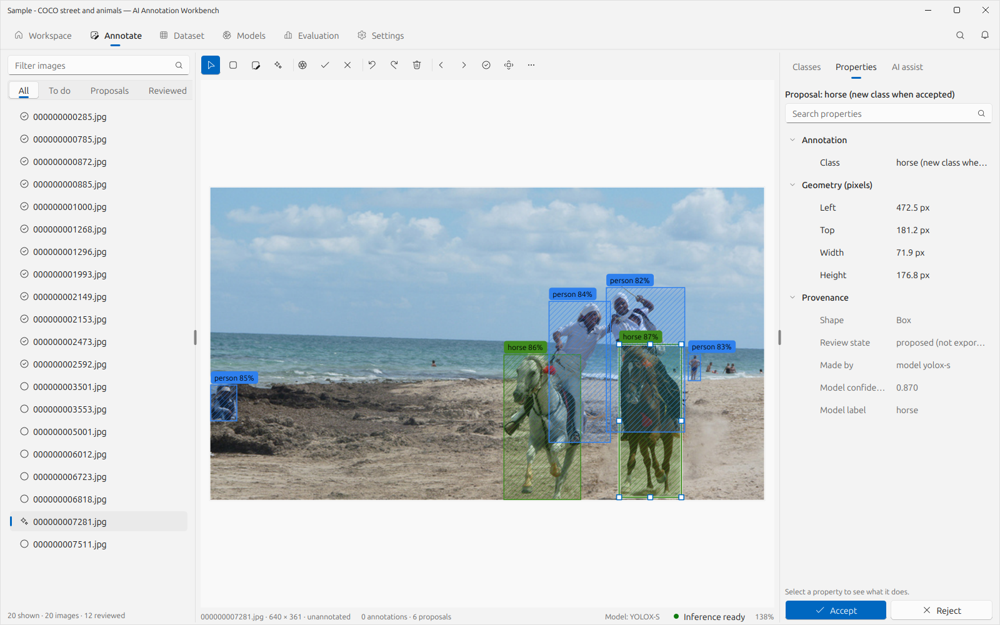
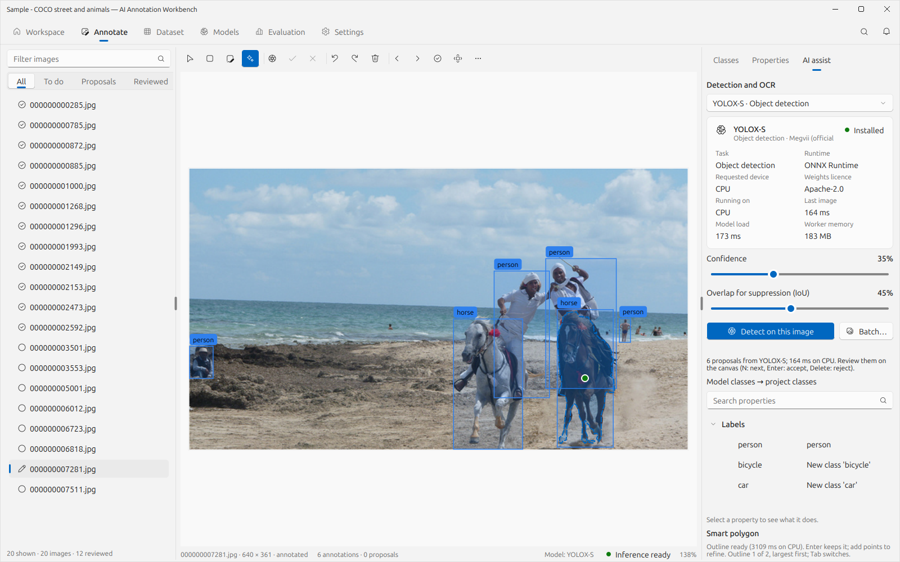
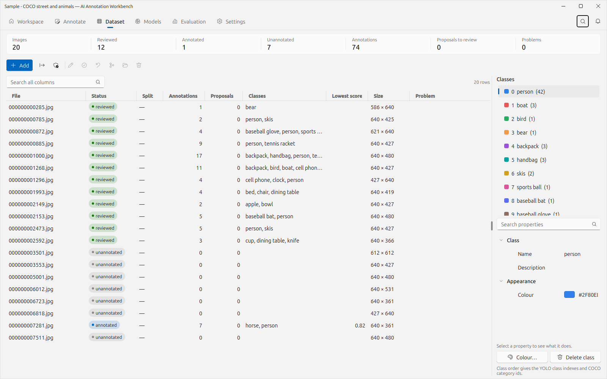
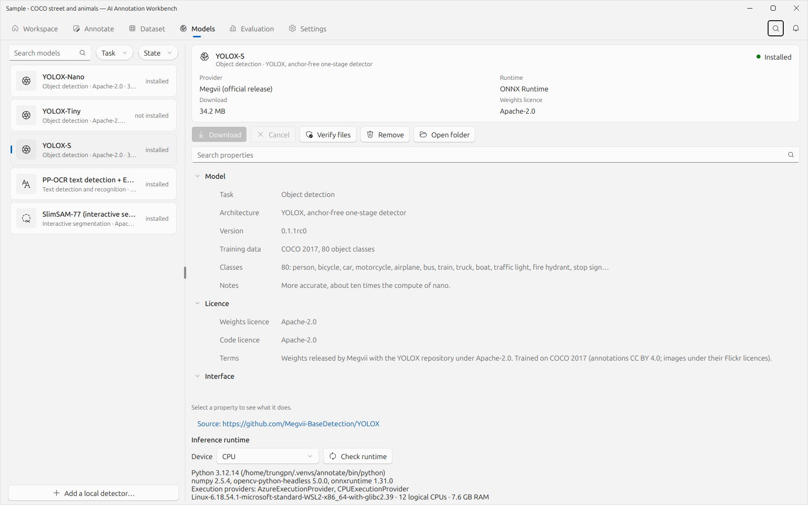
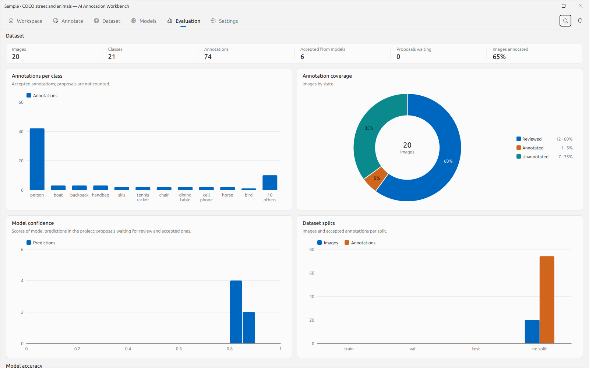
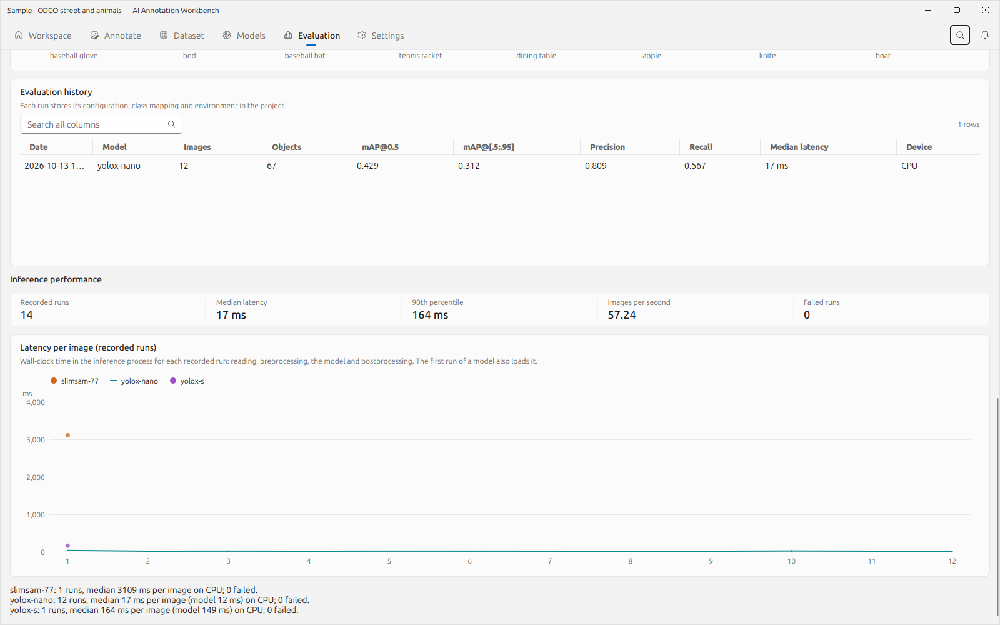
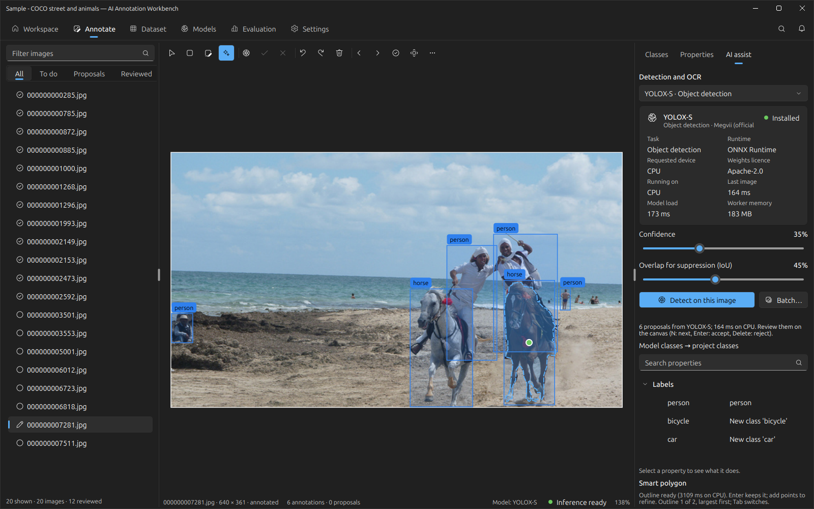
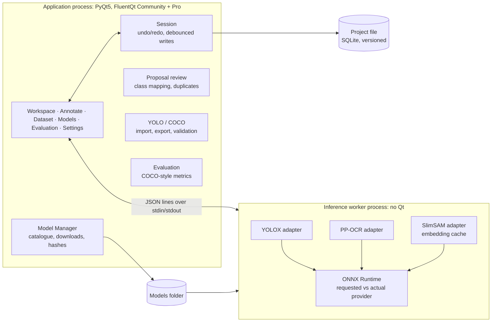

# AI Annotation Workbench

**A desktop workbench for labelling images for computer vision: draw boxes and polygons, let local models propose
annotations, review them, check the dataset, and export YOLO or COCO.**

> **About this repository.** It presents the application through screenshots, its design and its measured results.
> It contains no source code: the implementation is private at this stage, and it is built on FluentQt Community and
> FluentQt Pro, which are not publicly available either. The photos shown come from the COCO 2017 validation set
> (credited below).

<picture>
  <source media="(prefers-color-scheme: dark)" srcset="docs/images/02-annotate-proposals-dark.png">
  
</picture>

## What it is

Labelling is where most computer-vision projects spend their time. Models can help, but only if a person stays in
control of what goes into the dataset. In this workbench every model output is a **proposal**: hatched on the canvas,
attributed to the model and its score, and never exported until someone accepts it. Corrections are ordinary edits
with undo.

| | |
|---|---|
| **Annotate** | Boxes and polygons: draw, move, resize, edit vertices, undo/redo, zoom and pan, keyboard-first review (N next, Enter accept, Delete reject). Detection or OCR on one image or a batch, with cancel. **Smart polygon**: click an object and SlimSAM outlines it; Tab switches between the whole object and its parts; Enter keeps it. |
| **Dataset** | Data grid of every image: status, split, counts, classes, lowest score, problems; filters, multi-selection and batch actions. Import images, folders, YOLO and COCO. Validation lists what an export would skip or transform before anything is written. |
| **Models** | A catalogue-driven Model Manager: task, licence of weights and code, sources, files, sizes and SHA-256; downloads with progress, resume and cancel; verify, remove, offline use; a runtime check of the inference environment; your own YOLOX-format ONNX detectors. |
| **Evaluation** | Dataset statistics, and evaluation of a detector against reviewed images (mAP@0.5, mAP@[.5:.95], precision, recall, per-class AP) with the configuration and environment stored per run; latency and throughput from every recorded inference. |

## Screens

| | |
|---|---|
|  |  |
| **Smart polygon:** one click on the horse; the outline covers the animal and its rider, other candidate outlines a Tab away. | **Dataset:** the Pro data grid over the project, the class list and its property inspector. |
|  |  |
| **Model Manager:** licence, sources, files and checksums before download; the inference runtime as it really is. | **Dataset statistics:** classes, coverage, model confidence and splits. |
|  |  |
| **Evaluation history and inference performance**, from recorded runs. | **Dark theme.** |

## Architecture

* **Two processes.** The window never waits for a model. The worker owns ONNX Runtime and OpenCV, so the
  application starts and works without them: annotation, import, validation and export need no AI packages. A native
  crash in a model provider ends the worker, not the application. Requests carry ids, and replies the user has moved
  past are dropped.
* **Adapters behind one schema.** Every model family implements load, predict and close, and returns boxes or
  polygons in a common schema; review, storage, export and evaluation depend only on that schema. A new model of a
  known family is a catalogue entry; a new family is one adapter.
* **Honest device reporting.** ONNX Runtime silently drops a provider whose libraries fail to load. The worker
  compares the providers it asked for with those the session actually uses, and the UI and the evaluation records
  show the provider that ran and why it fell back.
* **Project file with migrations.** One SQLite file per project, numbered migrations, one transaction per operation.
  An older application refuses a newer project instead of damaging it. Images are referenced, not copied; a missing
  image keeps its annotations and appears in the validation report.

More: [docs/architecture.md](docs/architecture.md) · [docs/feature-matrix.md](docs/feature-matrix.md) ·
[docs/models.md](docs/models.md) · [docs/formats.md](docs/formats.md) · [docs/testing.md](docs/testing.md)

## Models

| Model | Task | Download | Licence |
|---|---|---|---|
| YOLOX-Nano / Tiny / S (Megvii) | Object detection, 80 COCO classes | 3.7 / 20 / 36 MB | Apache-2.0 |
| PP-OCRv4 det + PP-OCRv3 English rec (PaddleOCR; RapidOCR ONNX) | Text detection and recognition | 14 MB | Apache-2.0 |
| SlimSAM-77 int8 (from Segment Anything) | Click-to-segment | 14 MB | Apache-2.0 |

All downloaded on request from their publishers, with URLs pinned and checked against SHA-256; none are bundled.
Ultralytics YOLO models were left out on purpose: AGPL-3.0 weights would bind every distributed build.

## Measured

On a laptop CPU (Intel Core i5-1235U, no GPU), ONNX Runtime 1.31, CPU execution provider.

| | |
|---|---|
| YOLOX-Nano / Tiny / S, per image | median **20 / 56 / 219 ms** over 20 COCO photos (reading, preprocessing, model, postprocessing) |
| YOLOX-Nano, evaluation in the app (12 reviewed COCO images, 67 objects) | mAP@0.5 **0.429**, mAP@[.5:.95] 0.312, precision 0.81, recall 0.57; median 17 ms per image |
| SlimSAM-77 int8 | **3.0 s** for the first click on an image (image encoder, then cached), **0.1 s** for each further click |
| Windows standalone build (Nuitka) | 423 MB without model weights; every workspace opens, and the packaged worker detects objects in a COCO photo |
| Metric implementation | matches pycocotools on real COCO ground truth (automated test) |

Twelve images are a functional check of the evaluation pipeline, not a benchmark of YOLOX. Details and the full
test results: [docs/testing.md](docs/testing.md).

## Status

**Implemented and verified:**
- box and polygon annotation
- detection with proposal review
- OCR
- click-to-segment
- batch inference
- YOLO and COCO import and export
- validation
- evaluation
- the Model Manager
- a Windows standalone build smoke-tested with real inference

**Implemented, not verified:** CUDA and DirectML execution, because there is no supported GPU on the development
machine.

**Planned:**
- rotated boxes (DOTA)
- keypoints and pose
- instance segmentation models
- text-prompt grounding
- video annotation with tracking
- segmentation and OCR metrics

The [feature matrix](docs/feature-matrix.md) compares the application with the capabilities documented by
[X-AnyLabeling](https://github.com/CVHub520/X-AnyLabeling). It is far broader: it covers more tasks, model families and
formats, plus video, point clouds and remote inference. This workbench is a focused, independently written
application, not a fork, and is not affiliated with X-AnyLabeling.

## Technology

Python 3.12 · PyQt5 · [FluentQt](https://github.com/pntrungbk15/fluentqt-showcase) Community (widgets, settings,
`fluentqt.storage`) · FluentQt Pro (`TopNavigationWindow`, `ShapeEditor`, `PropertyInspector`, `DataGrid`,
`ChartView`, `ModelInfoCard`, `CommandPalette`) · ONNX Runtime · OpenCV · NumPy · SQLite · Nuitka (standalone builds).

## Credits

* Photos: [COCO 2017](https://cocodataset.org/) validation set, each under its Flickr licence (only CC BY, CC BY-SA,
  "no known copyright" and US-government photos are used); COCO annotations CC BY 4.0, the COCO Consortium.
* Models: [YOLOX](https://github.com/Megvii-BaseDetection/YOLOX) (Megvii, Apache-2.0),
  [PaddleOCR](https://github.com/PaddlePaddle/PaddleOCR) (Apache-2.0) via [RapidOCR](https://huggingface.co/SWHL/RapidOCR),
  [SlimSAM](https://github.com/czg1225/SlimSAM) (Apache-2.0) via [Xenova/slimsam-77-uniform](https://huggingface.co/Xenova/slimsam-77-uniform).

The screenshots and documents in this repository © Phạm Ngọc Trung; the photos within them remain under their own
licences.
